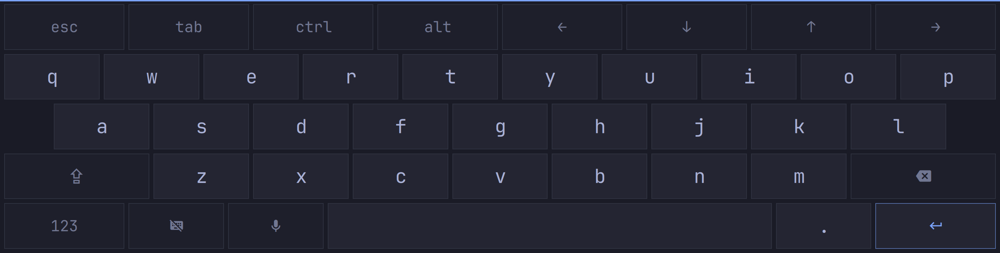

# On-Screen Keyboard for Omarchy

A touch keyboard drawn by Omarchy's own shell, in your theme's colors and font.
On a tablet or detachable it pops up when a text field is focused while the
keyboard is detached. It docks along the bottom of the screen or floats as a
small keyboard you can drag anywhere, like the iPad's.



- **Pops up on text fields** while in tablet mode, and hides again when the
  field loses focus or the keyboard is reattached.
- **Docked or floating.** Long-press the hide key, pinch the docked keyboard,
  or right-click the bar button to float it. Drag the floating keyboard by its
  handle; double-tap the handle (or spread two fingers) to dock it again.
- **Dictation key** for [voxtype](https://github.com/peteonrails/voxtype), which
  Omarchy sets up with `omarchy-voxtype-install`: tap to start, tap to stop. The
  key only appears when voxtype is installed.
- **A digit pad** for PIN, phone and number fields.
- **Esc, Tab, Ctrl, Alt and arrows** on an extra row for terminals.
- **Bar button** to show or hide the keyboard anytime, including without
  tablet mode.
- Follows theme and font changes live.

## Install

```bash
sudo pacman -S --needed python-pywayland
omarchy plugin add https://github.com/yeutterg/omarchy-on-screen-keyboard --enable
```

To put the show/hide button in the bar:

```bash
omarchy bar put io.github.yeutterg.onscreen-keyboard --section right
```

### Make it the only input method

Only one program can be the Wayland input method, and Omarchy starts fcitx5
for that role. While fcitx5 (or another keyboard like squeekboard) holds it,
this keyboard still works from the bar button but can't pop up on text fields;
the bar button's tooltip says so. To hand the role over, stop fcitx5 and keep
it from starting:

```bash
systemctl --user mask --now omarchy-fcitx5.service
```

Undo with `systemctl --user unmask omarchy-fcitx5.service` and a re-login. fcitx5
is what turns CapsLock compose sequences into text, so those stop working
while it's masked.

### Chromium and Electron apps

Chromium only tells the keyboard about text fields with Wayland IME enabled.
Add these two lines to `~/.config/chromium-flags.conf` and restart Chromium:

```
--enable-wayland-ime
--wayland-text-input-version=3
```

Electron apps take the same flags. You can still type into them without the
flags; the keyboard just won't pop up by itself.

## Remove

```bash
omarchy plugin remove io.github.yeutterg.onscreen-keyboard
```

It leaves nothing behind except its remembered position in
`~/.local/state/omarchy-onscreen-keyboard/`. If you masked fcitx5, unmask it
as shown above.

## How it works

- `Service.qml` draws the keyboard inside `omarchy-shell` as a layer-shell
  surface that never takes keyboard focus, so the app you're typing into keeps
  it.
- `helper/osk-helper.py` is a small Python program the service starts. It
  registers as the Wayland input method (`zwp_input_method_v2`) to learn when a
  text field is focused and what it wants (digits, text), and commits typed
  text into it. Keys like Backspace, Enter, arrows and Ctrl+C go through a
  virtual keyboard (`zwp_virtual_keyboard_v1`).
- Tablet mode comes from the kernel's tablet-mode switch: the service finds
  devices reporting `SW_TABLET_MODE` in `/proc/bus/input/devices` and adds
  Hyprland switch binds at runtime with `hyprctl eval`. Nothing in your
  Hyprland config is changed, and the binds are added again after a config
  reload. Devices without that switch get no automatic pop-up; use the bar
  button.
- Floating position and size are saved to
  `~/.local/state/omarchy-onscreen-keyboard/state.json`.

### Commands

```bash
omarchy-shell onscreen-keyboard show|hide|toggle
omarchy-shell onscreen-keyboard float|dock
omarchy-shell onscreen-keyboard status
omarchy-shell onscreen-keyboard setTabletMode true|false
```

`status` prints JSON including any problem the helper reported.

## Requirements

- Omarchy with the Quattro shell (Hyprland 0.56 or later)
- `python-pywayland`
- Optional: voxtype for dictation

## License

MIT. `helper/protocols/` holds the `input-method-unstable-v2` and
`virtual-keyboard-unstable-v1` protocol definitions from wlroots, under their
own MIT-style licenses (in each file).
